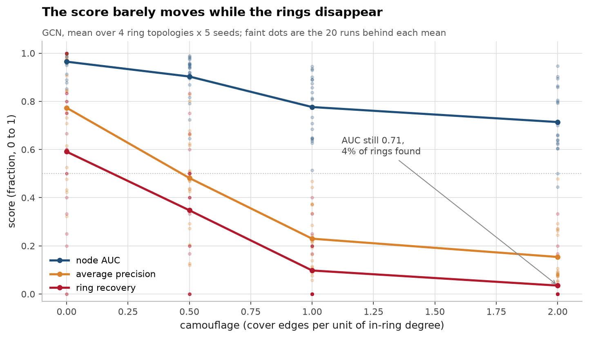
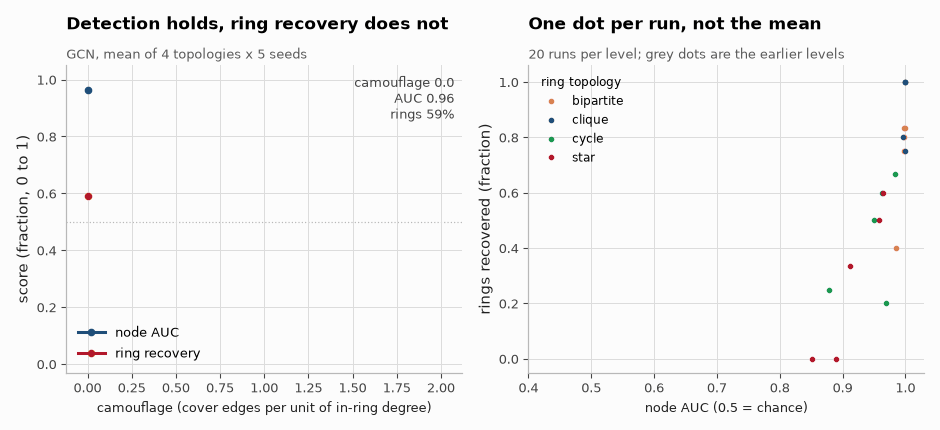
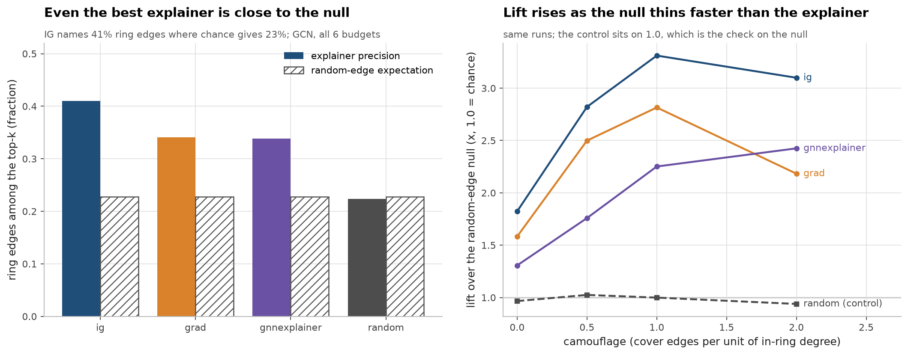
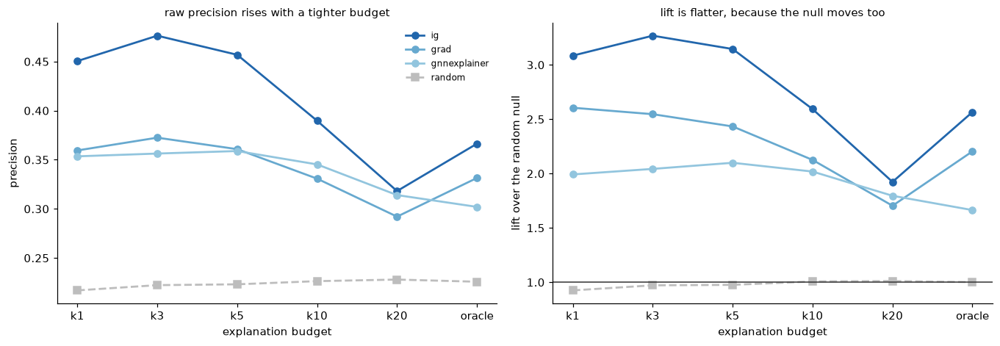
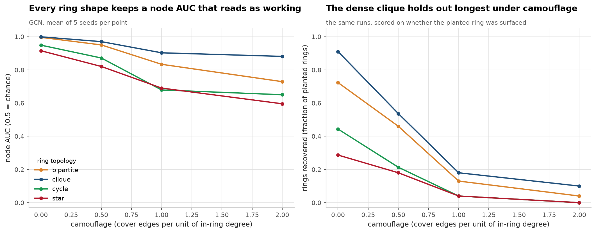
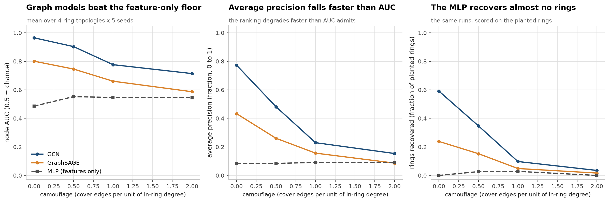

# RingFaith

**In GNN fraud detection, does the explanation point at the ring the model supposedly found?**

[](https://github.com/aghasalim/ring-faith/actions/workflows/ci.yml)
[](LICENSE)
[](https://doi.org/10.5281/zenodo.23003670)

---

## Abstract

Fraud-detection GNNs usually get reported by node-level AUC. But an investigator
doesn't act on a score. They act on the explanation, the handful of edges an
explainer says mattered. I wanted to measure how far those two drift apart. So I
kept apart three things that usually get lumped together. Node detection is AUC
and average precision. Ring recovery asks whether the planted collusion ring
showed up at all. Explanation faithfulness asks whether the explainer's top edges
recover the ring's own edges. The first two are prior art. The third is what I
add, along with the random-edge null that any faithfulness number has to be read
against.

I ran 80 configurations. That's 4 ring topologies by 4 camouflage levels, and
each pair gets 5 seeds. In total I trained 240 models. Each one gets 4
explainers, run at 6 budgets. That adds up to 131,136 faithfulness measurements.
The headline metric and the useful one end up far apart. At camouflage 2.0 a GCN
still scores 0.71 AUC, which reads as a working model, while ring recovery has
fallen from 59% to 3.5%. Explanation faithfulness never gets far off the floor.
Integrated Gradients is the best of the four, and it puts 41% of its top edges
inside the ring against a 23% random-edge expectation. Oddly, lift over that
null goes up with camouflage, and how fast depends on the explainer.
GNNExplainer goes from 1.3x at camouflage 0 to 2.4x at camouflage 2.0.
Integrated Gradients goes from 1.8x to 3.1x, with its peak of 3.3x at
camouflage 1.0. That's because the null thins out faster than the explainer
degrades. So lift only makes sense read next to precision.

What I'm contributing. (i) A planted-ring benchmark where I know the structure to
be explained by construction. (ii) An analytic random-edge null, checked by a
random explainer that sits on lift 1.0. (iii) Measurements at realistic
explanation budgets as well as at an oracle budget, which assumes you already
know the ring size. (iv) Evidence that node AUC tells you close to nothing about
whether the model found the collusion.

---

## 1. Findings
Here's the gap I built this repo to measure. If I push camouflage to 2.0, the
GCN's node AUC only slides from 0.96 to 0.71, which still looks like a working
model. Ring recovery over the same range goes from 59% to 3.5%. Five of the sixteen GCN
cells sit above 0.70 AUC with ring recall below 0.20, and across all three model
families it is 11 of 48. I score ring recall on the held-out test nodes, the
same ones AUC uses. An earlier version scored it on every node, including the
60% the model was trained on. That put the camouflage 0 figure at 78%.





*This is one model across the four measured camouflage levels, with the same topologies and seeds in every frame. Node AUC holds steady while ring recovery drops away.*

Full detail in [notes/METHODS.md](notes/METHODS.md#1-findings).
### What I did not find
I didn't find a bug in this harness. I looked hard for the two I expected most.
The id-ordering trap (F9) is real. I built the generator that way on purpose,
though, and guarded against it from the start, so it never corrupted a result.
The other was tie-breaking. Ring members hold the highest node ids. If a tied
block got ranked in index order, ring edges would go to the back and
faithfulness would be biased downward. That didn't happen either. The gradient
explainer's tie rate in float32 is 0.000. Index-order and random tie-breaking
give identical precision to three decimals on every topology.

Full detail in [notes/METHODS.md](notes/METHODS.md#what-i-did-not-find).
## 2. Results
Left: even Integrated Gradients puts only 41% of its top edges inside the ring, and the random-edge expectation for the same neighbourhoods is 23%. So a raw precision number mostly reflects how dense the neighbourhood is.
Right: lift over that null climbs as camouflage goes up.
GNNExplainer moves from 1.3x at camouflage 0 to 2.4x at camouflage 2.0, and
integrated gradients from 1.8x to 3.1x, peaking at 3.3x at camouflage 1.0. It
happens because the null thins out faster than the explainer gets worse. That's
why I read lift next to precision.



The full breakdown is in [notes/METHODS.md](notes/METHODS.md#2-results).
### Table 1, GCN: detection vs explanation faithfulness
| topology | camouflage | node AUC | ring recall | GNNExpl precision | random null | lift over null | candidate edges | nodes explained |
|:-----------|-------------:|-----------:|--------------:|--------------------:|--------------:|-----------------:|------------------:|------------------:|
| bipartite | 0 | 0.996 | 0.723 | 0.61 | 0.545 | 1.238 | 34 | 125 |
| bipartite | 0.5 | 0.95 | 0.46 | 0.366 | 0.253 | 1.621 | 73.072 | 125 |
| bipartite | 1 | 0.833 | 0.13 | 0.273 | 0.148 | 2.071 | 126.416 | 125 |
| bipartite | 2 | 0.729 | 0.04 | 0.197 | 0.086 | 2.345 | 243.568 | 125 |
| clique | 0 | 0.999 | 0.91 | 0.66 | 0.611 | 1.127 | 49.304 | 125 |
| clique | 0.5 | 0.97 | 0.537 | 0.352 | 0.187 | 1.994 | 165.608 | 125 |
| clique | 1 | 0.903 | 0.18 | 0.325 | 0.128 | 2.592 | 274.712 | 125 |
| clique | 2 | 0.881 | 0.1 | 0.144 | 0.104 | 1.434 | 626.848 | 125 |
| cycle | 0 | 0.949 | 0.443 | 0.357 | 0.287 | 1.806 | 21.264 | 125 |
| cycle | 0.5 | 0.871 | 0.213 | 0.186 | 0.148 | 1.485 | 37.376 | 125 |
| cycle | 1 | 0.679 | 0.04 | 0.099 | 0.099 | 0.985 | 52.72 | 125 |
| cycle | 2 | 0.65 | 0 | 0.101 | 0.054 | 2.18 | 94.816 | 125 |
| star | 0 | 0.915 | 0.287 | 0.448 | 0.415 | 1.13 | 23.024 | 125 |
| star | 0.5 | 0.82 | 0.18 | 0.299 | 0.294 | 1.037 | 34.512 | 125 |
| star | 1 | 0.69 | 0.04 | 0.242 | 0.175 | 1.53 | 60.784 | 125 |
| star | 2 | 0.596 | 0 | 0.174 | 0.109 | 2.048 | 87.112 | 125 |

Full detail in [notes/METHODS.md](notes/METHODS.md#table-1-gcn-detection-vs-explanation-faithfulness).
### Table 2, explainers, pooled over all cells
| model | explainer | precision mean | precision std | random_expectation mean | random_expectation std | lift mean | lift std |
|:--------|:-------------|-----------------:|----------------:|--------------------------:|-------------------------:|------------:|-----------:|
| gcn | gnnexplainer | 0.302 | 0.22 | 0.228 | 0.184 | 1.664 | 1.712 |
| gcn | grad | 0.331 | 0.207 | 0.228 | 0.184 | 2.204 | 2.511 |
| gcn | ig | 0.366 | 0.2 | 0.228 | 0.184 | 2.566 | 2.803 |
| gcn | random | 0.226 | 0.211 | 0.228 | 0.184 | 1.001 | 0.951 |
| sage | gnnexplainer | 0.326 | 0.225 | 0.232 | 0.188 | 1.905 | 2.091 |
| sage | grad | 0.389 | 0.204 | 0.232 | 0.188 | 2.642 | 2.706 |
| sage | ig | 0.389 | 0.204 | 0.232 | 0.188 | 2.642 | 2.706 |
| sage | random | 0.233 | 0.217 | 0.232 | 0.188 | 1.001 | 0.909 |

`sage grad` and `sage ig` match to every decimal. On a mean-aggregating model they're the same estimator (see F12).

Full detail in [notes/METHODS.md](notes/METHODS.md#table-2-explainers-pooled-over-all-cells).
### Table 3, structure-blind baseline

| topology   |   auc (gcn) |   auc (mlp) |   auc (sage) |   ring_recall (gcn) |   ring_recall (mlp) |   ring_recall (sage) |
|:-----------|------------:|------------:|-------------:|--------------------:|--------------------:|---------------------:|
| bipartite  |       0.877 |       0.515 |        0.684 |               0.338 |               0     |                0.051 |
| clique     |       0.938 |       0.555 |        0.803 |               0.432 |               0.017 |                0.23  |
| cycle      |       0.787 |       0.542 |        0.619 |               0.174 |               0.02  |                0.058 |
| star       |       0.755 |       0.518 |        0.687 |               0.127 |               0.018 |                0.117 |

### Table 4, the dissociation (averaged over camouflage)

| topology   |   node AUC |   GNNExpl precision |   lift over null |   AUC rank |   lift rank |
|:-----------|-----------:|--------------------:|-----------------:|-----------:|------------:|
| bipartite  |      0.877 |               0.362 |            1.819 |          2 |           1 |
| clique     |      0.938 |               0.37  |            1.787 |          1 |           2 |
| cycle      |      0.787 |               0.186 |            1.614 |          3 |           3 |
| star       |      0.755 |               0.291 |            1.436 |          4 |           4 |

### Table 5, random-explainer control calibration

|   mean random precision |   mean analytic null |   mean lift (should be ~1.0) |   n measurements |
|------------------------:|---------------------:|-----------------------------:|-----------------:|
|                  0.2293 |               0.2297 |                        1.001 |             3989 |

### Table 6, statistics quoted in the findings
| test | stat | p |
|:-----------------------------------------------------------------------|:-------------------|:----------|
| pearson r, node AUC vs GNNExpl precision (n=16 cells) | 0.769 | 4.94e-04 |
| pearson r, node AUC vs lift over null (n=16 cells) | -0.226 | 4.00e-01 |
| pearson r, random null vs GNNExpl precision (n=16 cells) | 0.945 | 3.35e-08 |
| wilcoxon, grad vs gnnexplainer precision (paired, n=3989) | 0.0462 | 1.81e-27 |
| grad wins / ties / loses vs gnnexplainer (%) | 42.6 / 24.0 / 33.4 | - |
| gcn gnnexplainer: beats own random null on % of nodes (n=2000) | 54.6 | 2.15e-66 |
| gcn grad: beats own random null on % of nodes (n=2000) | 60.9 | 1.90e-101 |
| gcn ig: beats own random null on % of nodes (n=2000) | 69.0 | 6.68e-147 |
| sage gnnexplainer: beats own random null on % of nodes (n=1989) | 60.6 | 8.27e-84 |
| sage grad: beats own random null on % of nodes (n=1989) | 71.1 | 4.51e-162 |
| sage ig: beats own random null on % of nodes (n=1989) | 71.1 | 4.51e-162 |
| bipartite: spearman(camouflage, node AUC) / spearman(camouflage, lift) | -1.0 / +1.0 | - |
| clique: spearman(camouflage, node AUC) / spearman(camouflage, lift) | -1.0 / +0.4 | - |
| cycle: spearman(camouflage, node AUC) / spearman(camouflage, lift) | -1.0 / +0.2 | - |
| star: spearman(camouflage, node AUC) / spearman(camouflage, lift) | -1.0 / +0.8 | - |

Full detail in [notes/METHODS.md](notes/METHODS.md#table-6-statistics-quoted-in-the-findings).
### Table 7, faithfulness on detected vs missed fraud nodes (oracle budget)
| model | explainer | detected lift | detected precision | detected n | missed lift | missed precision | missed n | lift difference | paired cells | wilcoxon p |
|:--------|:-------------|----------------:|---------------------:|-------------:|--------------:|-------------------:|-----------:|------------------:|---------------:|-------------:|
| gcn | gnnexplainer | 1.664 | 0.302 | 2000 | 1.158 | 0.194 | 466 | 0.505 | 67 | 3.18e-05 |
| gcn | grad | 2.204 | 0.331 | 2000 | 2.611 | 0.279 | 466 | -0.407 | 67 | 0.129 |
| gcn | ig | 2.566 | 0.366 | 2000 | 3.328 | 0.327 | 466 | -0.762 | 67 | 0.365 |
| gcn | random | 1.001 | 0.226 | 2000 | 0.992 | 0.17 | 466 | 0.009 | 67 | 0.508 |
| sage | gnnexplainer | 1.905 | 0.326 | 1989 | 1.655 | 0.25 | 1009 | 0.25 | 79 | 2.03e-05 |
| sage | grad | 2.642 | 0.389 | 1989 | 3.071 | 0.362 | 1009 | -0.429 | 79 | 0.324 |
| sage | ig | 2.642 | 0.389 | 1989 | 3.071 | 0.362 | 1009 | -0.429 | 79 | 0.324 |
| sage | random | 1.001 | 0.233 | 1989 | 0.989 | 0.185 | 1009 | 0.012 | 79 | 0.503 |

Full detail in [notes/METHODS.md](notes/METHODS.md#table-7-faithfulness-on-detected-vs-missed-fraud-nodes-oracle-budget).
### Table 8, mean lift over the null by explanation budget (detected nodes)

| explainer    |    k1 |    k3 |    k5 |   k10 |   k20 |   oracle |
|:-------------|------:|------:|------:|------:|------:|---------:|
| gnnexplainer | 1.92  | 2.058 | 2.182 | 2.156 | 1.831 |    1.784 |
| grad         | 3.002 | 2.896 | 2.718 | 2.313 | 1.865 |    2.423 |
| ig           | 3.242 | 3.258 | 3.075 | 2.548 | 1.975 |    2.604 |
| random       | 0.922 | 0.976 | 0.979 | 1.005 | 1.008 |    1.001 |

### Table 9, mean lift over the null by explanation budget (missed nodes)

| explainer    |    k1 |    k3 |    k5 |   k10 |   k20 |   oracle |
|:-------------|------:|------:|------:|------:|------:|---------:|
| gnnexplainer | 1.109 | 1.307 | 1.459 | 1.768 | 1.77  |    1.498 |
| grad         | 3.527 | 3.361 | 3.263 | 2.77  | 2.169 |    2.926 |
| ig           | 4.182 | 3.854 | 3.595 | 2.986 | 2.253 |    3.152 |
| random       | 0.895 | 0.951 | 0.992 | 1.025 | 1.022 |    0.99  |

### Table 10, does the gradient still beat GNNExplainer at a realistic budget?
| budget | comparison | challenger lift | gnnexpl lift | mean precision margin | wins / ties / losses (%) | wilcoxon p | n |
|:---------|:---------------------|------------------:|---------------:|------------------------:|:---------------------------|-------------:|-----:|
| k1 | grad vs gnnexplainer | 3.002 | 1.92 | 0.0719 | 26.4 / 54.3 / 19.3 | 1.79e-11 | 3989 |
| k3 | grad vs gnnexplainer | 2.896 | 2.058 | 0.0592 | 40.5 / 31.7 / 27.9 | 1.77e-09 | 3989 |
| k5 | grad vs gnnexplainer | 2.718 | 2.182 | 0.029 | 40.6 / 27.2 / 32.2 | 2.44e-10 | 3989 |
| k10 | grad vs gnnexplainer | 2.313 | 2.156 | -0.0019 | 34.5 / 29.3 / 36.2 | 0.718 | 3989 |
| k20 | grad vs gnnexplainer | 1.865 | 1.831 | -0.0044 | 31.4 / 37.8 / 30.8 | 0.0207 | 3989 |
| oracle | grad vs gnnexplainer | 2.423 | 1.784 | 0.0462 | 42.6 / 24.0 / 33.4 | 1.81e-27 | 3989 |
| k1 | ig vs gnnexplainer | 3.242 | 1.92 | 0.1176 | 28.2 / 55.3 / 16.5 | 1.16e-28 | 3989 |
| k3 | ig vs gnnexplainer | 3.258 | 2.058 | 0.1113 | 44.6 / 32.8 / 22.5 | 4.46e-47 | 3989 |
| k5 | ig vs gnnexplainer | 3.075 | 2.182 | 0.0772 | 46.2 / 27.7 / 26.1 | 5.43e-66 | 3989 |
| k10 | ig vs gnnexplainer | 2.548 | 2.156 | 0.0277 | 39.9 / 29.9 / 30.2 | 3.78e-25 | 3989 |
| k20 | ig vs gnnexplainer | 1.975 | 1.831 | 0.0086 | 35.0 / 39.2 / 25.7 | 2.23e-10 | 3989 |
| oracle | ig vs gnnexplainer | 2.604 | 1.784 | 0.0637 | 47.1 / 24.4 / 28.6 | 7.46e-60 | 3989 |

For the plain gradient, no. Its margin over GNNExplainer is +0.072 at k=1.
By k=10 it's down to -0.002 (p = 0.72), and at k=20 it's -0.004. Integrated
gradients keeps a margin at every budget. At k=1 it's +0.118, and at k=20 it's
still +0.009. A positive margin means the challenger beats GNNExplainer.

Table 7 is paired by experimental cell. Nodes inside one cell share a graph and a trained model, so pooling them would overstate n by two orders of magnitude.

Full detail in [notes/METHODS.md](notes/METHODS.md#table-10-does-the-gradient-still-beat-gnnexplainer-at-a-realistic-budget).
### 2.1 Does the budget change the answer?



`oracle` hands the explainer the true number of ring edges. The first version of
this repo measured at that budget. You don't get it at inference time, since
knowing how big the ring is was the whole question. At the fixed budgets an
investigator actually gets, raw precision climbs as the budget tightens. Lift
stays much flatter, because the null tightens too. The random explainer sits on
1.0 the whole way. That only checks the null.

## 3. What this is, and what it is not
Ring-level ground truth for fraud graphs isn't my idea. TravelFraudBench
(arXiv:2604.21093) already plants rings in travel networks and reports ring-level
recovery. GraphSAGE hits 100% across their ring types. A tabular MLP gets 17 to
88%. LAS-GNN detects laundering motifs directly. Neither of them asks whether the
explainer attached to the detector points at the ring. That's the only thing I
add here. It's an edge-level layer, scored against the planted motif's own edges
and against a random-edge null.

Full detail in [notes/METHODS.md](notes/METHODS.md#3-what-this-is-and-what-it-is-not).
## 4. Method
My generator plants disjoint rings of four shapes into a preferential-attachment
background graph. Camouflage then adds cover edges to legitimate nodes, in
proportion to a member's degree inside the motif. Camouflage acts on structure,
so the ring's shape decides how long it lasts. In my runs a clique is still 10%
recovered at camouflage 2.0, while the star and the cycle are down to 4% and
4% by camouflage 1.0. The second figure shows the floor under all of this. A
structure-blind MLP on the same features scores 0.515 to 0.555 AUC by topology.
It recovers almost no rings, 1.4% on average. So anything a graph model scores
above that comes from the structure.




Full detail in [notes/METHODS.md](notes/METHODS.md#4-method).
## 5. Limitations

Synthetic only. There's no real transaction graph. I built the generator as a
controlled instrument for one specific question.

The edges are plain. Mine are undirected and static, with no attributes. Real
fraud graphs are directed and timestamped, and they carry amounts. Motifs like
scatter-gather are defined by direction and time, so I can't represent them here.

There's one feature mechanism, a single mean shift on one dimension. A different
feature-signal design could move the detection numbers a lot.

I only have three explainers plus the null. They're GNNExplainer, the plain
gradient and integrated gradients. I haven't run PGExplainer, SubgraphX or
attention. Two of the three are gradient attributions that coincide exactly on
GraphSAGE (F12), so there's less real variety than the count suggests. A
negative result for GNNExplainer doesn't carry over to all explainers.

Homophily is built in. Ring members share a feature shift and are also densely
connected, which is where GNNs do best. I don't cover heterophilous fraud, like a
mule that looks exactly like its legitimate neighbours.

The oracle budget flatters the plain gradient in particular. By default `k` is
the true number of motif edges, and no investigator has that. F5 now reports
what happens without it. I still haven't tested the middle ground, a budget
picked by a heuristic (a fraction of the candidate set, or a score threshold)
that sits between an oracle and a flat constant.

I explain missed nodes with respect to the fraud class. That's the sensible
choice operationally, and it keeps the detected and missed groups comparable,
but it's still a choice. The other convention is to explain whatever the model
predicted, which on a missed node is "legitimate". The code supports it
(`target_class=None`), but I didn't run it.

I measure faithfulness on missed nodes per node, not per ring. A node the model
missed may still sit in a ring that was mostly recovered. Conditioning at the
ring level would be a different cut, and probably a sharper one.

The graphs are small. Dense adjacency is `O(N²)`, and everything here is under
~1.5k nodes. I haven't tested scaling at all.

## 6. Reproducibility

```bash
make venv     # .venv + editable install
make test     # 61 tests
make sweep    # the full sweep: 4 explainers x 6 budgets, ~45 min on 4 cores
make demo     # the degenerate-split finding
make report   # rebuild the tables in this README from reports/*.csv
```

`experiments/make_tables.py` regenerates every table above from the CSVs in
`reports/`, and `experiments/run_sweep.py` writes those CSVs. I typed the numbers
in the prose by hand, though, and that's the step that tends to rot. So `verify/`
re-derives every published figure straight from the raw tables in SQL, C, Go, R,
Rust, Node, Ruby and Java. If there's a typo in this README, the build goes red.

## 7. Repository layout

```
src/ringfaith/
  generate.py   graph generator + exact ground truth
  models.py     GCN / GraphSAGE / MLP on a dense adjacency
  explain.py    GNNExplainer, gradient, integrated gradients, random null
  metrics.py    AUC/AP, ring recall, edge faithfulness
  split.py      stratified split + degeneracy check
  experiment.py one experimental cell
experiments/    run_sweep.py, degenerate_split_demo.py, make_tables.py
tests/          61 pytest tests on the generator, the metrics and the explainers
reports/        result CSVs and JSON written by the runs above
                (faithfulness_raw.csv.gz is the 131k-row per-node table)
verify/         the same tables recomputed in SQL, C, Go, R, Rust, Node, Ruby
                and Java, driven by verify.sh
```

## 8. References

I checked that each of these exists at the time of writing. I left out anything I couldn't resolve.

- Sajja. *TravelFraudBench: A Configurable Evaluation Framework for GNN Fraud
  Ring Detection in Travel Networks.* arXiv:2604.21093, 2026.
- *LAS-GNN: A Graph Neural Network for Temporal Money Laundering Motif
  Detection.* ACM ICAIF 2025. doi:10.1145/3768292.3770410
- Ying, Bourgeois, You, Zitnik, Leskovec. *GNNExplainer: Generating
  Explanations for Graph Neural Networks.* arXiv:1903.03894, 2019.
- Sundararajan, Taly, Yan. *Axiomatic Attribution for Deep Networks.*
  arXiv:1703.01365, 2017.
- Kipf, Welling. *Semi-Supervised Classification with Graph Convolutional
  Networks.* arXiv:1609.02907, 2016.
- Hamilton, Ying, Leskovec. *Inductive Representation Learning on Large Graphs.*
  arXiv:1706.02216, 2017.
- Barabási, Albert. *Emergence of Scaling in Random Networks.* Science 286, 1999.

## License

MIT.
